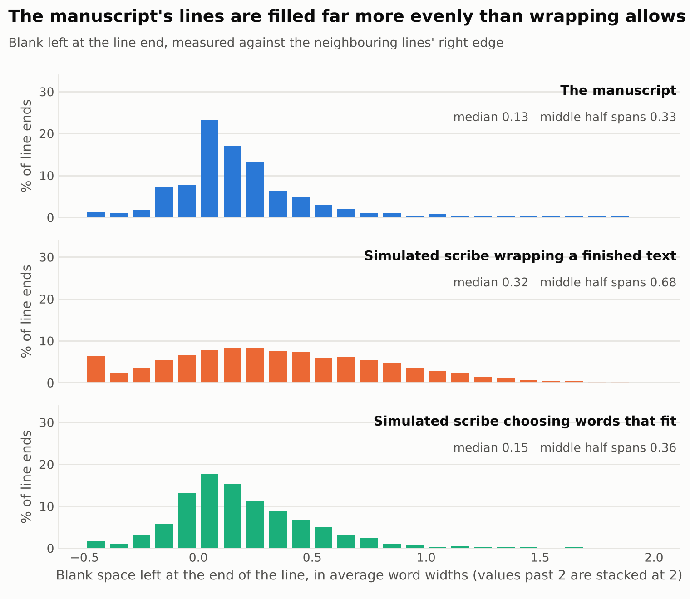
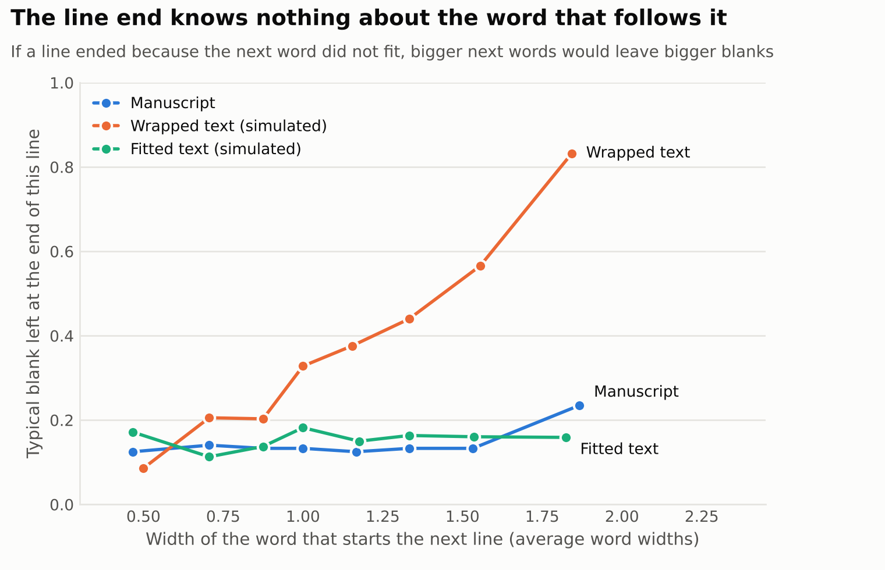
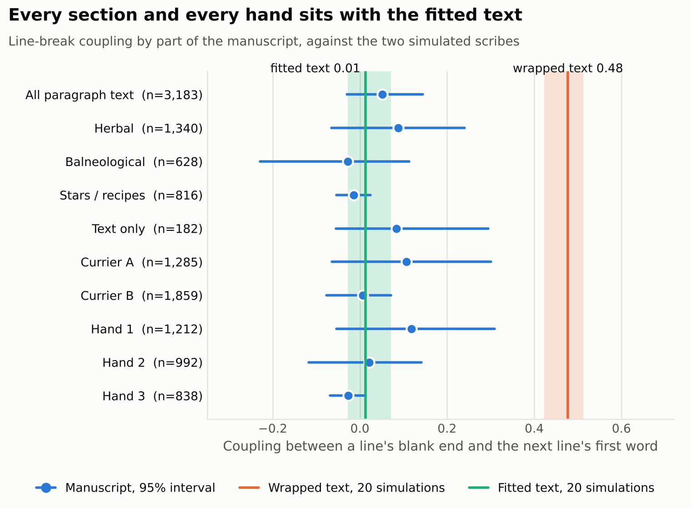
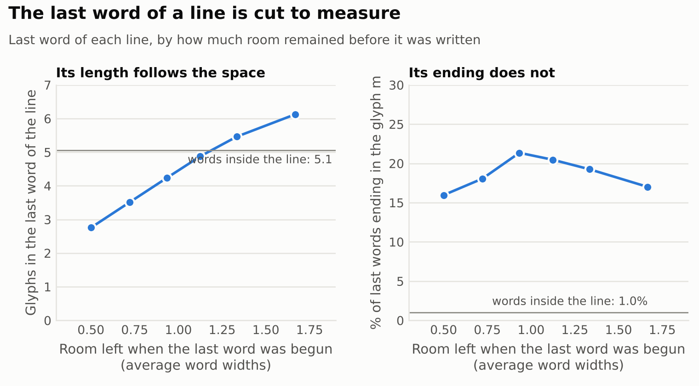
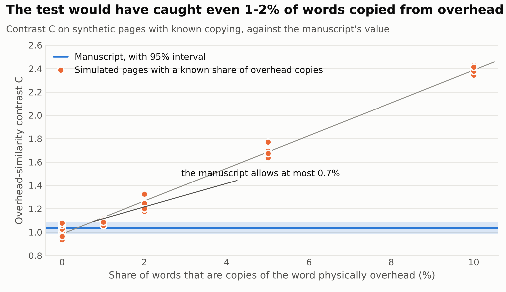

# Poured or fitted? Physical line-break forensics of the Voynich manuscript

**Voynich lines are fitted to the space, not wrapped at the first word that fails to fit. So are the lines of real 15th-century manuscripts.**

This study measures the manuscript's text in pixel space, using a bounding box for every word, and asks when a line ends: because the next word of an existing text did not fit, or because the scribe filled the space?

The first version of this report read the answer as evidence that the text was not copied from a finished text. A control on real manuscripts (section 4) shows that reading was wrong: scribes copying known French prose leave the same fingerprint. What is left is a description of how Voynich lines end, and one difference from the real manuscripts.

## Findings

1. **Voynich lines are fitted, not mechanically wrapped.** Across 3,183 line breaks, the blank at a line's end is unrelated to the width of the word that starts the next line (coupling 0.05, 95% interval −0.03 to 0.14). Mechanically wrapping the same words on the same pages gives 0.48.
2. **Real scribes do the same.** Six French prose manuscripts of the 15th century, measured the same way, give couplings from −0.44 to +0.29, five of them at or below +0.09. Mechanical wrapping of their own words gives +0.18 to +0.51. The fitted line end is ordinary scribal practice.
3. **One difference survives.** Voynich lines end on shorter-than-average words (−9%). All six real manuscripts end lines on longer-than-average words (+13% to +26%).
4. **Words are not copied from the word physically above them.** At most 0.7% of words can be such copies. The Timm–Schinner generator's own output scores about the same on this test, so this limits the naive picture of copying, not their algorithm.

## Data

Word boxes come from voynichese.com (one box per word of Takahashi's transliteration, on page images about 600 px wide), joined by character alignment to the Zandbergen–Landini transliteration (ZL3b) for line, paragraph, section and hand labels. Running paragraph text only: 33,528 words on 3,968 lines.

All lengths are in **word widths**: the median word-box width on that page (about 45 px).

## 1. Lines are fitted, not wrapped

A scribe writing out a text that already exists breaks the line when the next word will not fit. That leaves two fingerprints:

- the blank at the line end is anywhere from nothing to a whole word, and
- the blank is smaller than the next line's first word, because that word is the one that did not fit. Lines followed by long words therefore end earlier.

A scribe who chooses what to write leaves neither.

To know what each fingerprint looks like on these pages, three simulated scribes re-lay the manuscript's own word stream, with the real box widths, on the real page geometry:

- the **wrapper** puts the next word on the line if it fits, otherwise starts a new line;
- the **squeezer** does the same but may compress the last word by up to 30%;
- the **fitter**, near the line end, takes the first of the next twelve words that fits and leaves the rest in order.





| | Median blank | Middle-half spread | Coupling to next word |
|---|---|---|---|
| Manuscript | 0.13 | 0.33 | 0.05 (−0.03 to 0.14) |
| Wrapper, 20 runs | 0.32 | 0.68 | 0.48 (0.42 to 0.51) |
| Squeezer, 20 runs | 0.17 | 0.48 | 0.33 (0.29 to 0.36) |
| Fitter, 20 runs | 0.15 | 0.36 | 0.01 (−0.03 to 0.07) |

*Coupling* is the regression slope of the blank on the next line's first-word width, within page. Manuscript interval: bootstrap over pages. Simulations: mean and range.

The result holds in every section and for every hand with enough lines to measure. The pharmaceutical section (166 breaks) is too small to say anything: 0.31, interval −0.15 to 1.16.



### Loopholes tested

| Alternative explanation | Test | Result |
|---|---|---|
| The scribe stretched or squeezed the writing to hit the margin | Repeat with widths predicted from each word's glyphs instead of measured widths | Coupling −0.07 (−0.18 to 0.04); wrapper 0.45 |
| | Is the last word narrower than its glyphs predict? | By 0.05 word widths, and the gap before it shrinks by 0.07. Closing the distance to a wrapped text needs about 0.35 |
| Words are split across the line break | Is "last word + next line's first word" a known word? | 1.0% of the time, against 4.3% for neighbours inside a line |
| The last word is padding added after the real next word failed to fit | Couple the room *before* the last word to the next line's first word | 0.09; wrapper 0.59, fitter 0.05 |
| The last word is just any word that happens to fit | Replace it with a random mid-line word that fits the same room | Spread of the blank rises from 0.33 to 0.57 |
| Short or broken lines distort it | Keep only lines of six or more words | Manuscript 0.01, wrapper 0.47 |
| The inferred right edge is wrong | Use no edge at all: within a paragraph, does a line stop further left when the next line starts with a wider word? | Manuscript 0.00; wrapper −0.45, fitter −0.02 (wrapping predicts about −0.5) |

## 2. The last word is cut to measure



The last word's length tracks the room left for it. This is not distinctive: the real manuscripts in section 4 show the same pattern (about 2.2 characters when room is tight, 6.5 when it is wide), and part of it is built in, because the room includes the word that was written into it.

The last word's length tracks the room left for it. Its ending does not: 18% of line-final words end in the glyph `m`, against 1% elsewhere, and that share is about the same whether the room was tight or generous. The line-end mark follows the count (this is the last word); the length follows the pixels.

Two long-known oddities come out of fitting without further assumptions. In the manuscript, line-first words are 9% wider than mid-line words and line-last words 10% narrower. The fitter gives +9% and −16%; the wrapper gives +10% and +1%.

A line is also closed off statistically. The last glyph of a word predicts the first glyph of the next word (0.17 bits between neighbours inside a line, 0.01 for words one apart). The link is intact between the second-last and last word of a line (0.17 bits) and gone across the break, whether measured from the last word (0.004 bits) or the second-last (−0.001). So the last word belongs to its line, and nothing carries over to the next one.

## 3. No copying from the word overhead

The self-citation hypothesis (Timm & Schinner) holds that the text was produced by copying and modifying words already on the page. A simple version says a word is often a variant of the word above it.

For every word, each earlier word on its page was scored as similar (within one edit) or not, and expressed relative to how often two random words of that page are similar. Words overhead do score higher, but they score equally higher on lines 6 to 20 above, where copying from overhead cannot be the cause. That part is a position-in-line effect.


The *overhead contrast* divides the overhead advantage on the two lines above by the same advantage on lines 7 to 20 above. It is 1.0 when nothing is copied from overhead.

| | Overhead contrast |
|---|---|
| Manuscript | 1.04 (0.98 to 1.09) |
| Synthetic pages, no copying, 12 runs | 1.00 ± 0.04 |
| Synthetic pages, 1% of words copied from overhead | 1.09 |
| Synthetic pages, 5% copied from overhead | 1.70 |
| Timm–Schinner generator output, its own lines, 3 seeds | 1.06, 1.07, 1.11 |
| Naibbe cipher of Latin, wrapped | 1.04 (0.97 to 1.11) |
| Latin (Pliny), wrapped | 0.95 (0.83 to 1.08) |



Reading the manuscript's upper limit off the calibration gives at most 0.7% of words copied from overhead, with a best estimate of 0.4%. What the manuscript does show is a diffuse effect: a word is 23% more likely than chance to resemble a word on the line above, 15% for three lines up, 6% for ten, at any horizontal offset.

## 4. Control: real manuscripts

Six manuscripts from `Gallicorpora/HTR-MSS-15e-Siecle` (15th-century French, line-level ground truth, commit `707a106`), main text zones only. Each word gets a synthetic box whose width is proportional to its character count, and the result goes through the same code as the Voynich pages, including the simulated wrapper and fitter on each manuscript's own words.

| Manuscript (Gallica id) | Line breaks | Median blank | Coupling (95%) | Its own wrapper | Its own fitter | Last word vs mid-line length |
|---|---|---|---|---|---|---|
| btv1b100737746 | 462 | 0.27 | −0.08 (−0.23 to 0.12) | 0.37 | 0.12 | +13% |
| btv1b55008562q | 1,046 | 0.28 | 0.07 (0.03 to 0.10) | 0.18 | 0.08 | +15% |
| btv1b90069505 | 1,124 | 0.31 | −0.19 (−0.30 to −0.09) | 0.39 | 0.17 | +14% |
| btv1b9009670t | 438 | 0.56 | 0.29 (0.10 to 0.55) | 0.45 | 0.11 | +26% |
| btv1b90595325 | 394 | 0.37 | −0.44 (−0.75 to −0.15) | 0.42 | 0.19 | +21% |
| btv1b90616967 | 416 | 0.33 | 0.09 (−0.03 to 0.18) | 0.51 | 0.23 | +18% |
| **Voynich** | 3,183 | 0.13 | 0.05 (−0.03 to 0.14) | 0.48 | 0.01 | −9% |

Real scribes copying real text do not break the line at the first word that fails to fit. Their line ends carry little or no trace of the next word, as in the Voynich. The coupling test separates mechanical wrapping from scribal line-filling. It does not separate a copied text from one composed on the page.

Reproduce with `python3 control_real/control_real.py <path to the cloned dataset>`.

## 5. Nothing connects words across a break

Inside a line, how one word ends predicts how the next begins. The *link* is the mutual information between the last glyph of one word and the first glyph of the next, less what shuffled pairs from the same page give.


- **The link fades with the physical gap.** It is 0.37 bits for the most tightly spaced fifth of word pairs and 0.04 for the most widely spaced fifth. Many spaces in the transliteration are therefore not word breaks; Rozanova & Temerev (2026) reached this from the same boxes.
- **It is zero at every physical break.** Across a drawing that interrupts a line: 0.00 (575 pairs). Across a line break: 0.00 (3,246 pairs).
- **Real manuscripts carry on across the line break.** In the six French manuscripts the link is 0.08 to 0.15 bits inside a line and 0.19 to 0.37 across the line break. It rises because scribes split words between lines.
- **The break is not hiding a continuous text.** 53% of line-start words begin with `y`, `d` or `s`, and for three quarters of those the rest is a known word, so a line-start prefix is real. Removing it does not bring the link back, nor does using the second glyph, nor keeping only line starts without a prefix and line ends without `m`: every variant gives at most 0.01 bits, against 0.03 to 0.05 for widely spaced words inside a line.
- **Neither published model has a link at all.** Timm–Schinner generator output: 0.00 inside a line. Naibbe cipher of Latin: 0.00.

So the Voynich scribes never split a word across a line or a drawing, and nothing about the end of one stretch of writing predicts the start of the next. Real scribes of the period did both. Together with the short last words (section 4), this is how Voynich lines differ from real ones: they are filled without carrying anything over.

What this cannot tell apart: a text composed one line at a time, and a text whose scribes kept a strict rule of ending every line on a whole word and shortening it to fit.

Reproduce with `python3 src/exp5_continuity.py <path to the cloned French dataset>`.

## 6. Two more absences: word order and repeated phrases

Corpora of the same size (about 34,000 words), neighbouring words inside a line only, line-first and line-last words excluded.

| | Word-order strength | Repeated word triples, vs shuffled lines |
|---|---|---|
| Six real French manuscripts | 0.85 | ×23.5 |
| Latin (Pliny) | 0.77 | ×13.4 |
| **Voynich** | 0.24 | ×2.7 |
| Voynich, neighbours written far apart | 0.11 | |
| Voynich, neighbours written close together | 0.45 | |
| Naibbe cipher of Latin | 0.14 | ×3.3 |
| Timm–Schinner generator | 0.34 | ×1.9 |

*Word-order strength*: for two words found next to each other, how one-sided the order is, from 0 (a coin flip) to 1 (always the same way round), corrected for chance.

Real text has a firm word order and repeats its phrases. The Voynich has neither. The little order it shows sits in closely written pairs, which are often pieces of one word; between words written clearly apart it is 0.11.

This does not show the text is empty. A cipher that turns each letter or pair of letters of real Latin into a "word" (Naibbe) loses both properties in the same way. It shows that Voynich words do not behave as the words of a sentence.

Reproduce with `python3 src/exp7_absences.py`.

## 7. A transformer context test (inconclusive)

A small character-level transformer (0.4M parameters, CPU-trained) was trained per corpus to predict each line from the three lines before it, and tested with those lines intact, with the words inside them shuffled, replaced by other lines of the page, or removed. If a text runs on, shuffling should cost something.

| | Cost of shuffling the preceding lines (bits per character, 95% interval) |
|---|---|
| Six real French manuscripts | +0.006 (+0.003 to +0.009) |
| Latin (Pliny) | +0.001 (−0.001 to +0.003) |
| Voynich | −0.002 (−0.004 to 0.000) |
| Naibbe cipher of Latin | +0.001 (0.000 to +0.002) |
| Timm–Schinner generator | +0.001 (−0.002 to +0.003) |

The test did not work as a measurement. Plain Latin, which certainly runs on, shows no cost, and every model predicted better with no context at all than with the true context, so the models never learned to use the preceding lines. At 34,000 words per corpus and CPU-scale training this is expected. The Voynich's zero therefore says nothing. The French value is real but small, and probably comes from words split across lines.

A usable version needs either GPU-scale training or a pretrained model; neither was available here. Script: `src/exp6_llm_context.py <corpus>`.

## 8. Which kind of real text does it resemble?

Eighteen Latin texts of different kinds (psalms, ritual law, census lists, genealogies, gospel, monastic rule, cooking recipes, a farm handbook with charms, an official list, star myths, astrology in verse, epic verse, war narrative, encyclopedia, law, a building manual, etymologies, annals), each described by eight alphabet-independent numbers in windows of 7,500 words: neighbouring words identical, neighbouring words within one letter, word-order strength, repeated triples, vocabulary size, share of the ten commonest words, recurrence within 30 words, spread of word length.

| | Neighbours identical | Neighbours within one letter | Word order | Repeated triples vs chance | Distance to the Voynich (six measures) |
|---|---|---|---|---|---|
| **Voynich** | 1.0% | 3.6% | 0.26 | ×4.8 | |
| Eighteen real texts, range | 0–0.3% | 0–0.7% | 0.46–0.95 | ×4.2–×51.8 | 4.4–9 |
| Psalms | 0.2% | 0.6% | 0.85 | ×15.5 | 6.4 |
| Apicius, cooking recipes | 0.2% | 0.4% | 0.74 | ×22.4 | 5.4 |
| Chronicles I, genealogies | 0.3% | 0.3% | 0.68 | ×4.2 | 6.1 |
| Vergil, epic verse | 0.0% | 0.1% | 0.46 | ×28.1 | 4.6 |
| Timm–Schinner generator | 0.6% | 3.1% | 0.31 | ×3.9 | 1.5 |
| Naibbe cipher of Latin | 0.1% | 1.2% | 0.06 | ×2.5 | 2.1 |

The distance uses the six measures other than the two neighbour-repeat rates, standardised across the real texts. Two real texts are typically 2.9 apart.

- **No kind of real text is close.** The nearest are verse (4.4 and 4.6), then recipes, the official list and the genealogies (5.4 to 6.1). Each is further from the Voynich than real texts usually are from each other.
- **Religious and other repetitive texts repeat phrases, not words.** Psalms repeat three-word phrases fifteen times more than chance and keep a firm word order. The Voynich repeats the same or nearly the same word side by side, three to five times more often than any real text here, and keeps neither phrases nor order.
- **The Voynich lies outside the whole real range on four of the eight measures**: both neighbour-repeat rates (above), word order (below), and spread of word length (below).
- **Both artificial models are closer than any real text**: 1.5 and 2.1. Only the Timm–Schinner generator reproduces the side-by-side repeats.

Limits: the real texts are Latin in modern editions, and a transliterated Voynich glyph is not the same size of unit as a Latin letter, which affects the within-one-letter measure.

Reproduce with `python3 src/exp8_genres.py <path to the Latin Library clone>` (`cltk/lat_text_latin_library`, commit `76229ac`).

## What this means

- The Voynich line end looks like the work of a scribe filling lines, which is what scribes of the period did with ordinary texts. It is not evidence that the text was made up on the page, and the earlier version of this report was wrong to read it that way.
- The remaining difference is in how the line is filled. Real scribes end lines on long words, which is what happens when the word straddling the margin is squeezed in. Voynich scribes end lines on short words and start the next line with long ones (+9%).
- The side-tests in sections 1 and 2 (no squeezing of the last word, no split words, no link between words across the line break) still describe the Voynich. They have not been run on a second real corpus with true word boxes, so how unusual they are is open.
- None of this bears on whether the text is meaningful.

## Limits

- The control uses synthetic word boxes (width from character count) and line ends from transcription baselines, so its blanks are noisier than the Voynich's. It covers one dataset, one language, six manuscripts, taken as prose from their transcriptions.
- A line's available right edge is inferred from neighbouring lines of the same paragraph, not observed. The simulations are measured by the same estimator.
- Herbal pages have irregular right edges where drawings intrude, so their intervals are wide.
- Voynich boxes are quantised to 3 px and follow one transliteration.

## Prior work

A background search (limited: voynich.ninja, arXiv and several blogs were unreachable from this environment) found no earlier test of whether the next word would have fitted the measured blank. The closest work found:

- Currier, and Vogt (2012), on the line as a functional unit; Vogt already modelled wrapping in character counts.
- voynich.ninja threads (2026) re-breaking the text greedily in character counts.
- `d2kx/voynich-research`: last-word length against line fullness in glyph counts, and the flat `-m` rate.
- `eo777/vms-spatial` and `vms-dynamic-citation` (2026): word boxes used to test self-citation with a visibility cone; its same-position test was inconclusive.
- Rozanova & Temerev (2026), whose archive supplies the data used here, used the boxes to validate word gaps.

The overhead-copy result therefore confirms earlier null results with a pixel measurement and adds a calibrated limit. The line-break test and its control on real manuscripts were not found elsewhere. Treat that as "not found", not "proven absent".

## Reproduce

```sh
./fetch_data.sh                 # third-party data, pinned commit
pip install numpy scipy pandas matplotlib rapidfuzz
python3 src/exp2_wrap.py        # line-break test            -> results/exp2_wrap.json
python3 src/exp3_lineend.py     # last-word follow-ups       -> results/exp3_lineend.json
python3 src/exp1_kernel.py      # overhead-copy test (~40 min) -> results/exp1_kernel.json
python3 src/figures.py
```

| File | Purpose |
|---|---|
| `src/vdata.py` | Word boxes joined to ZL3b; line and paragraph structure |
| `src/wrap.py` | Line-end measurements and the three simulated scribes |
| `src/pairs.py`, `src/kernel.py` | Word-pair similarity by position; overhead contrast |
| `src/layout.py` | Synthetic pages on the real geometry |
| `control_real/control_real.py` | The same line-end measurements on real manuscripts |

## Data credits

Not redistributed here; `fetch_data.sh` clones them from the archive of L. Rozanova and A. Temerev (`lrozanova/voynich-units`), which keeps the original terms.

- ZL3b transliteration: R. Zandbergen and G. Landini.
- Word boxes: voynichese.com, over T. Takahashi's transliteration.
- Self-citation generator output: T. Timm and A. Schinner's algorithm, as archived there.
- Naibbe cipher text: M. Greshko.
- Latin text: Pliny, *Naturalis Historia*, Tesserae edition.
- Control manuscripts: Gallicorpora, *Données HTR manuscrits du 15e siècle* (transcribed by N. Leroy), cloned separately.
