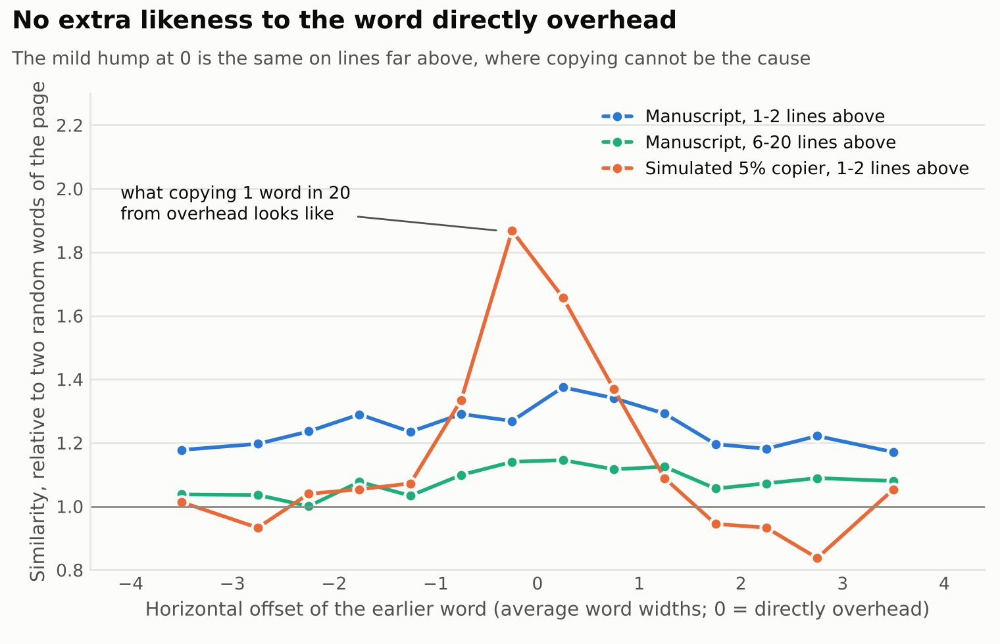

# Poured or fitted? Physical line-break forensics of the Voynich manuscript

**The Voynich scribes did not wrap a finished text into lines. They chose what to write so that each line came out full.**

This study measures the manuscript's text in pixel space, using a bounding box for every word, and asks a question that transliterations alone cannot answer: when a line ends, is that because the next word of an existing text did not fit, or because the scribe picked words to fill the space?

It is not a decipherment. It is a physical constraint that any decipherment has to satisfy.

## Findings

1. **Lines are fitted, not wrapped.** Across 3,183 line breaks, the blank left at a line's end is unrelated to the width of the word that starts the next line (coupling 0.05, 95% interval −0.03 to 0.14). Wrapping a finished text on the same pages gives 0.48.
2. **The last word of each line is cut to measure.** It averages 2.8 glyphs when half a word-width of room is left and 6.1 glyphs when there is room for one and two-thirds. That is one word in eight across the manuscript.
3. **Words are not copied from the word physically above them.** At most 0.7% of words can be such copies. The Timm–Schinner generator's own output scores about the same on this test, so this limits the naive picture of copying, not their algorithm.

## Data

Word boxes come from voynichese.com (one box per word of Takahashi's transliteration, on page images about 600 px wide), joined by character alignment to the Zandbergen–Landini transliteration (ZL3b) for line, paragraph, section and hand labels. Running paragraph text only: 33,528 words on 3,968 lines.

All lengths are in **word widths**: the median word-box width on that page (about 45 px).

## 1. Lines are fitted, not wrapped

A scribe writing out a text that already exists breaks the line when the next word will not fit. That leaves two fingerprints:

- the blank at the line end is anywhere from nothing to a whole word, and
- the blank is smaller than the next line's first word, because that word is the one that did not fit. Lines followed by long words therefore end earlier.

A scribe who chooses what to write leaves neither.

To know what each fingerprint looks like on these pages, three simulated scribes re-lay the manuscript's own word stream, with the real box widths, on the real page geometry:

- the **wrapper** puts the next word on the line if it fits, otherwise starts a new line;
- the **squeezer** does the same but may compress the last word by up to 30%;
- the **fitter**, near the line end, takes the first of the next twelve words that fits and leaves the rest in order.


| | Median blank | Middle-half spread | Coupling to next word |
|---|---|---|---|
| Manuscript | 0.13 | 0.33 | 0.05 (−0.03 to 0.14) |
| Wrapper, 20 runs | 0.32 | 0.68 | 0.48 (0.42 to 0.51) |
| Squeezer, 20 runs | 0.17 | 0.48 | 0.33 (0.29 to 0.36) |
| Fitter, 20 runs | 0.15 | 0.36 | 0.01 (−0.03 to 0.07) |

*Coupling* is the regression slope of the blank on the next line's first-word width, within page. Manuscript interval: bootstrap over pages. Simulations: mean and range.

The result holds in every section and for every hand with enough lines to measure. The pharmaceutical section (166 breaks) is too small to say anything: 0.31, interval −0.15 to 1.16.


### Loopholes tested

| Alternative explanation | Test | Result |
|---|---|---|
| The scribe stretched or squeezed the writing to hit the margin | Repeat with widths predicted from each word's glyphs instead of measured widths | Coupling −0.07 (−0.18 to 0.04); wrapper 0.45 |
| | Is the last word narrower than its glyphs predict? | By 0.05 word widths, and the gap before it shrinks by 0.07. Closing the distance to a wrapped text needs about 0.35 |
| Words are split across the line break | Is "last word + next line's first word" a known word? | 1.0% of the time, against 4.3% for neighbours inside a line |
| The last word is padding added after the real next word failed to fit | Couple the room *before* the last word to the next line's first word | 0.09; wrapper 0.59, fitter 0.05 |
| The last word is just any word that happens to fit | Replace it with a random mid-line word that fits the same room | Spread of the blank rises from 0.33 to 0.57 |
| Short or broken lines distort it | Keep only lines of six or more words | Manuscript 0.01, wrapper 0.47 |
| The inferred right edge is wrong | Use no edge at all: within a paragraph, does a line stop further left when the next line starts with a wider word? | Manuscript 0.00; wrapper −0.45, fitter −0.02 (wrapping predicts about −0.5) |

## 2. The last word is cut to measure


The last word's length tracks the room left for it. Its ending does not: 18% of line-final words end in the glyph `m`, against 1% elsewhere, and that share is about the same whether the room was tight or generous. The line-end mark follows the count (this is the last word); the length follows the pixels.

Two long-known oddities come out of fitting without further assumptions. In the manuscript, line-first words are 9% wider than mid-line words and line-last words 10% narrower. The fitter gives +9% and −16%; the wrapper gives +10% and +1%.

A line is also closed off statistically. The last glyph of a word predicts the first glyph of the next word (0.17 bits between neighbours inside a line, 0.01 for words one apart). The link is intact between the second-last and last word of a line (0.17 bits) and gone across the break, whether measured from the last word (0.004 bits) or the second-last (−0.001). So the last word belongs to its line, and nothing carries over to the next one.

## 3. No copying from the word overhead

The self-citation hypothesis (Timm & Schinner) holds that the text was produced by copying and modifying words already on the page. A simple version says a word is often a variant of the word above it.

For every word, each earlier word on its page was scored as similar (within one edit) or not, and expressed relative to how often two random words of that page are similar. Words overhead do score higher, but they score equally higher on lines 6 to 20 above, where copying from overhead cannot be the cause. That part is a position-in-line effect.



The *overhead contrast* divides the overhead advantage on the two lines above by the same advantage on lines 7 to 20 above. It is 1.0 when nothing is copied from overhead.

| | Overhead contrast |
|---|---|
| Manuscript | 1.04 (0.98 to 1.09) |
| Synthetic pages, no copying, 12 runs | 1.00 ± 0.04 |
| Synthetic pages, 1% of words copied from overhead | 1.09 |
| Synthetic pages, 5% copied from overhead | 1.70 |
| Timm–Schinner generator output, its own lines, 3 seeds | 1.06, 1.07, 1.11 |
| Naibbe cipher of Latin, wrapped | 1.04 (0.97 to 1.11) |
| Latin (Pliny), wrapped | 0.95 (0.83 to 1.08) |


Reading the manuscript's upper limit off the calibration gives at most 0.7% of words copied from overhead, with a best estimate of 0.4%. What the manuscript does show is a diffuse effect: a word is 23% more likely than chance to resemble a word on the line above, 15% for three lines up, 6% for ten, at any horizontal offset.

## What this means

- The scribe decided what went at the end of each line while looking at the space left. A fixed sequence of these words, written out and wrapped at the margin, is not what the pages show. That applies to plain-language readings and to word-for-word ciphers alike.
- Three accounts remain open. The text was composed on the page, line by line. Or the writing system lets the same content be written longer or shorter (abbreviation, or a cipher with optional long and short encodings) and the scribe used that freedom at line ends. Or the source was already laid out in these lines, which moves the question back one step.
- None of this shows the text is meaningless.
- For anyone attempting a reading: treat each line as a unit, do not read across line breaks as continuous text, and expect the last word of a line to carry layout as well as content.

## Limits

- No real medieval manuscript of known text was measured the same way. The wrapper and fitter are simulations. A 15th-century manuscript with word boxes is the control that would settle how real scribes behave, and it is the obvious next step.
- A line's available right edge is inferred from neighbouring lines of the same paragraph, not observed. The simulations are measured by the same estimator.
- Herbal pages have irregular right edges where drawings intrude, so their intervals are wide.
- Boxes are quantised to 3 px and follow one transliteration.

## Prior work

A background search (limited: voynich.ninja, arXiv and several blogs were unreachable from this environment) found no earlier test of whether the next word would have fitted the measured blank. The closest work found:

- Currier, and Vogt (2012), on the line as a functional unit; Vogt already modelled wrapping in character counts.
- voynich.ninja threads (2026) re-breaking the text greedily in character counts.
- `d2kx/voynich-research`: last-word length against line fullness in glyph counts, and the flat `-m` rate.
- `eo777/vms-spatial` and `vms-dynamic-citation` (2026): word boxes used to test self-citation with a visibility cone; its same-position test was inconclusive.
- Rozanova & Temerev (2026), whose archive supplies the data used here, used the boxes to validate word gaps.

Finding 3 therefore confirms earlier null results with a pixel measurement and adds a calibrated limit. Findings 1 and 2 were not found elsewhere. Treat that as "not found", not "proven absent".

## Reproduce

```sh
./fetch_data.sh                 # third-party data, pinned commit
pip install numpy scipy pandas matplotlib rapidfuzz
python3 src/exp2_wrap.py        # line-break test            -> results/exp2_wrap.json
python3 src/exp3_lineend.py     # last-word follow-ups       -> results/exp3_lineend.json
python3 src/exp1_kernel.py      # overhead-copy test (~40 min) -> results/exp1_kernel.json
python3 src/figures.py
```

| File | Purpose |
|---|---|
| `src/vdata.py` | Word boxes joined to ZL3b; line and paragraph structure |
| `src/wrap.py` | Line-end measurements and the three simulated scribes |
| `src/pairs.py`, `src/kernel.py` | Word-pair similarity by position; overhead contrast |
| `src/layout.py` | Synthetic pages on the real geometry |

## Data credits

Not redistributed here; `fetch_data.sh` clones them from the archive of L. Rozanova and A. Temerev (`lrozanova/voynich-units`), which keeps the original terms.

- ZL3b transliteration: R. Zandbergen and G. Landini.
- Word boxes: voynichese.com, over T. Takahashi's transliteration.
- Self-citation generator output: T. Timm and A. Schinner's algorithm, as archived there.
- Naibbe cipher text: M. Greshko.
- Latin text: Pliny, *Naturalis Historia*, Tesserae edition.
