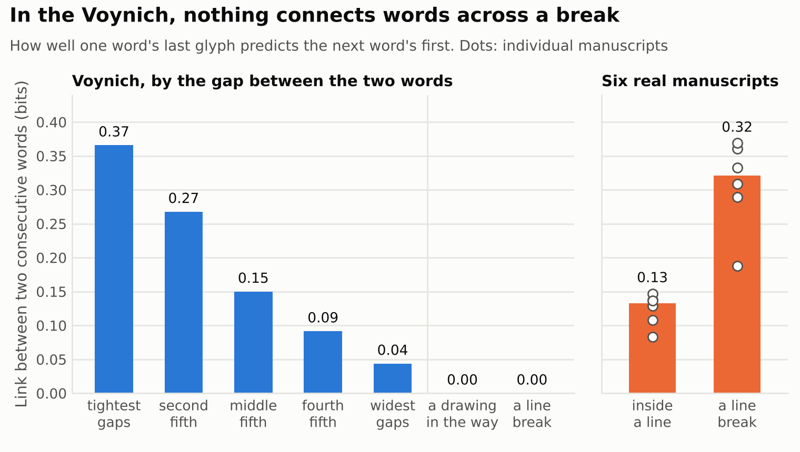
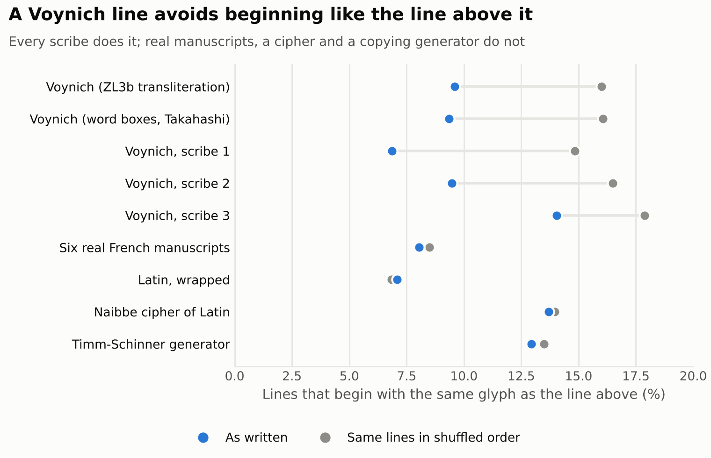
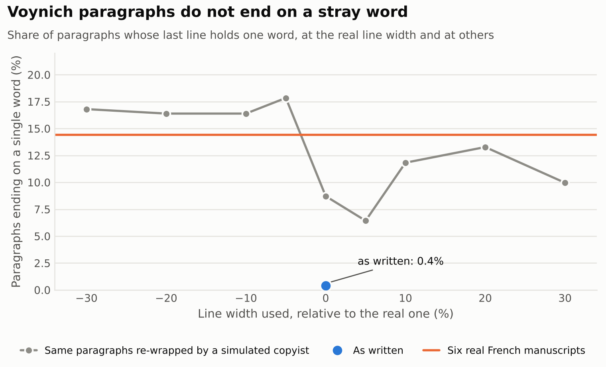

# Poured or fitted? Physical line-break forensics of the Voynich manuscript

**Voynich lines are fitted to the space, not wrapped at the first word that fails to fit. So are the lines of real 15th-century manuscripts.**

This study measures the manuscript's text in pixel space, using a bounding box for every word, and asks when a line ends: because the next word of an existing text did not fit, or because the scribe filled the space?

The first version of this report read the answer as evidence that the text was not copied from a finished text. A control on real manuscripts (section 4) shows that reading was wrong: scribes copying known French prose leave the same fingerprint. What is left is a description of how Voynich lines end, and one difference from the real manuscripts.

## Findings

This report was audited by seven independent agents told to break it (section 17). Three of its earlier claims did not survive and are marked withdrawn. What stands:

| Result | Status after audit | Whose |
|---|---|---|
| A line avoids opening with the same glyph as the line above: 9.6% against 16.2% shuffled; 7.5% against 13.5% in a second transliteration | Replicated on three transliterations, survives every control. Strong for hands 1 and 2, weak for hand 3. | Published first by Q. Quadrada (Oct 2026) as "vertical dissimilation"; replicated here |
| Paragraphs rarely end on a short last line: a single word about 2% of the time (0.6–2.2% across three sources) against about 12% (9–14%) for a text that simply runs out | Replicated independently. 3 to 6 times rarer than chance; about 2 times for two words or fewer. | No earlier statement found in about 130 searches |
| Like for like against real manuscripts (a short line after three full ones holds one word): Voynich 0.5% (2 of 425); 83 prose manuscripts 8.4% (1,832 cases); 49 verse manuscripts 0.8% | Holds against prose. Verse and one chapter-title list match the Voynich | Not found elsewhere |
| Across 367 real manuscripts and samples in 12 languages, line-start avoidance is absent from prose (83 manuscripts, 7.9% against 7.5% shuffled) and verse (49), and present in itemised lists (four, e.g. 6.0% against 11.7%) | New context for the rule in the first row | Comparison not found elsewhere |
| A word follows itself as often as chance in the Voynich (ratio 1.07); real manuscripts give a median of 0.06 and at most 0.54 over 207, except a table of dice-lot numerals at 1.02 | Stands | The page-shuffled version is in arXiv:2610.34499; the within-line version and the manuscript comparison are additions |
| Voynich line ends are not mechanically wrapped: coupling 0.02–0.05 against 0.44–0.50 for a simulated wrapper | Robust | The short last word and the absence of squeezing are in Quadrada's rulebook |
| Real scribes also fill their lines | Holds, but the gap to their own simulated wrapping is modest (+0.05 to +0.13 against +0.14 to +0.25) and rests on 50 pages | |
| Words are not copied from the word overhead: at most 0.7% | Stands; confirms earlier nulls | Bound is new |

**Withdrawn**

- *Pages are fuller than packing whole paragraphs allows* (section 16). An artefact: the page images are content crops scaled to a common size, so "the foot of the page" was the bottom of the image. Frame-independent measures show nothing.
- *Vocabulary follows the pictures more than the scribe* (section 11). The samples were unbalanced; with equal pages per sample the difference is +0.02 (−0.03 to +0.05).
- *Line openings take turns* (section 12). The excess two lines down is forced by the avoidance one line down and is not a separate effect.
- *The text was not copied from a finished text* as inferred from line ends (sections 1–2), withdrawn earlier after the real-manuscript control.

What the surviving results support: the opening word of each line was chosen with the line above in view, and paragraphs were ended, or their text adjusted, so as not to leave a stray word. The real copied prose measured here shows neither.

Across 367 real manuscripts the same measures separate continuous prose from itemised lists, verse and number tables, and the Voynich falls with the second group on all three.

They do not prove the text was composed for the page. A simulated copyist of real Latin reproduces both, and the line-end behaviour, if he plans a whole paragraph ahead and may squeeze or stretch his writing by 6–8% (section 17). The manuscript's lines vary in density by only 1–2%, less than that needs, so such a copyist would have had to vary the written forms of words, as abbreviation does. Three readings remain: composed as written; line-structured like verse; or copied by scribes who planned each paragraph and adjusted word forms to fit, a habit not seen in the real manuscripts compared.

## Data

Word boxes come from voynichese.com (one box per word of Takahashi's transliteration, on page images about 600 px wide), joined by character alignment to the Zandbergen–Landini transliteration (ZL3b) for line, paragraph, section and hand labels. Running paragraph text only: 33,528 words on 3,968 lines.

All lengths are in **word widths**: the median word-box width on that page (about 45 px).

## 1. Lines are fitted, not wrapped

A scribe writing out a text that already exists breaks the line when the next word will not fit. That leaves two fingerprints:

- the blank at the line end is anywhere from nothing to a whole word, and
- the blank is smaller than the next line's first word, because that word is the one that did not fit. Lines followed by long words therefore end earlier.

A scribe who chooses what to write leaves neither.

To know what each fingerprint looks like on these pages, three simulated scribes re-lay the manuscript's own word stream, with the real box widths, on the real page geometry:

- the **wrapper** puts the next word on the line if it fits, otherwise starts a new line;
- the **squeezer** does the same but may compress the last word by up to 30%;
- the **fitter**, near the line end, takes the first of the next twelve words that fits and leaves the rest in order.


| | Median blank | Middle-half spread | Coupling to next word |
|---|---|---|---|
| Manuscript | 0.13 | 0.33 | 0.05 (−0.03 to 0.14) |
| Wrapper, 20 runs | 0.32 | 0.68 | 0.48 (0.42 to 0.51) |
| Squeezer, 20 runs | 0.17 | 0.48 | 0.33 (0.29 to 0.36) |
| Fitter, 20 runs | 0.15 | 0.36 | 0.01 (−0.03 to 0.07) |

*Coupling* is the regression slope of the blank on the next line's first-word width, within page. Manuscript interval: bootstrap over pages. Simulations: mean and range.

The result holds in every section and for every hand with enough lines to measure. The pharmaceutical section (166 breaks) is too small to say anything: 0.31, interval −0.15 to 1.16.


### Loopholes tested

| Alternative explanation | Test | Result |
|---|---|---|
| The scribe stretched or squeezed the writing to hit the margin | Repeat with widths predicted from each word's glyphs instead of measured widths | Coupling −0.07 (−0.18 to 0.04); wrapper 0.45 |
| | Is the last word narrower than its glyphs predict? | By 0.05 word widths, and the gap before it shrinks by 0.07. Closing the distance to a wrapped text needs about 0.35 |
| Words are split across the line break | Is "last word + next line's first word" a known word? | 1.0% of the time, against 4.3% for neighbours inside a line |
| The last word is padding added after the real next word failed to fit | Couple the room *before* the last word to the next line's first word | 0.09; wrapper 0.59, fitter 0.05 |
| The last word is just any word that happens to fit | Replace it with a random mid-line word that fits the same room | Spread of the blank rises from 0.33 to 0.57 |
| Short or broken lines distort it | Keep only lines of six or more words | Manuscript 0.01, wrapper 0.47 |
| The inferred right edge is wrong | Use no edge at all: within a paragraph, does a line stop further left when the next line starts with a wider word? | Manuscript 0.00; wrapper −0.45, fitter −0.02 (wrapping predicts about −0.5) |

## 2. The last word is cut to measure


The last word's length tracks the room left for it. This is not distinctive: the real manuscripts in section 4 show the same pattern (about 2.2 characters when room is tight, 6.5 when it is wide), and part of it is built in, because the room includes the word that was written into it.

The last word's length tracks the room left for it. Its ending does not: 18% of line-final words end in the glyph `m`, against 1% elsewhere, and that share is about the same whether the room was tight or generous. The line-end mark follows the count (this is the last word); the length follows the pixels.

Two long-known oddities come out of fitting without further assumptions. In the manuscript, line-first words are 9% wider than mid-line words and line-last words 10% narrower. The fitter gives +9% and −16%; the wrapper gives +10% and +1%.

A line is also closed off statistically. The last glyph of a word predicts the first glyph of the next word (0.17 bits between neighbours inside a line, 0.01 for words one apart). The link is intact between the second-last and last word of a line (0.17 bits) and gone across the break, whether measured from the last word (0.004 bits) or the second-last (−0.001). So the last word belongs to its line, and nothing carries over to the next one.

## 3. No copying from the word overhead

The self-citation hypothesis (Timm & Schinner) holds that the text was produced by copying and modifying words already on the page. A simple version says a word is often a variant of the word above it.

For every word, each earlier word on its page was scored as similar (within one edit) or not, and expressed relative to how often two random words of that page are similar. Words overhead do score higher, but they score equally higher on lines 6 to 20 above, where copying from overhead cannot be the cause. That part is a position-in-line effect.


The *overhead contrast* divides the overhead advantage on the two lines above by the same advantage on lines 7 to 20 above. It is 1.0 when nothing is copied from overhead.

| | Overhead contrast |
|---|---|
| Manuscript | 1.04 (0.98 to 1.09) |
| Synthetic pages, no copying, 12 runs | 1.00 ± 0.04 |
| Synthetic pages, 1% of words copied from overhead | 1.09 |
| Synthetic pages, 5% copied from overhead | 1.70 |
| Timm–Schinner generator output, its own lines, 3 seeds | 1.06, 1.07, 1.11 |
| Naibbe cipher of Latin, wrapped | 1.04 (0.97 to 1.11) |
| Latin (Pliny), wrapped | 0.95 (0.83 to 1.08) |


Reading the manuscript's upper limit off the calibration gives at most 0.7% of words copied from overhead, with a best estimate of 0.4%. What the manuscript does show is a diffuse effect: a word is 23% more likely than chance to resemble a word on the line above, 15% for three lines up, 6% for ten, at any horizontal offset.

## 4. Control: real manuscripts

Six manuscripts from `Gallicorpora/HTR-MSS-15e-Siecle` (15th-century French, line-level ground truth, commit `707a106`), main text zones only: 50 pages, 1,940 line breaks. (The dataset ships each page twice, raw and character-normalised; an earlier version of this report read both. All figures here use one copy.) Each word gets a synthetic box whose width is proportional to its character count, and the result goes through the same code as the Voynich pages, including the simulated wrapper and fitter on each manuscript's own words.

| Manuscript (Gallica id) | Line breaks | Median blank | Coupling (95%) | Its own wrapper | Its own fitter | Last word vs mid-line length |
|---|---|---|---|---|---|---|
| btv1b100737746 | 231 | 0.27 | −0.08 (−0.30 to 0.14) | 0.38 | 0.12 | +13% |
| btv1b55008562q | 523 | 0.28 | 0.07 (0.01 to 0.12) | 0.18 | 0.08 | +15% |
| btv1b90069505 | 562 | 0.31 | −0.19 (−0.36 to −0.05) | 0.39 | 0.17 | +14% |
| btv1b9009670t | 219 | 0.56 | 0.29 (0.01 to 0.66) | 0.45 | 0.11 | +26% |
| btv1b90595325 | 197 | 0.37 | −0.44 (−0.93 to −0.03) | 0.42 | 0.19 | +21% |
| btv1b90616967 | 208 | 0.33 | 0.09 (−0.10 to 0.22) | 0.52 | 0.23 | +17% |
| **Voynich** | 3,183 | 0.13 | 0.05 (−0.03 to 0.14) | 0.48 | 0.01 | −9% |

Real scribes copying real text do not break the line at the first word that fails to fit. Their line ends carry little or no trace of the next word, as in the Voynich. The coupling test separates mechanical wrapping from scribal line-filling. It does not separate a copied text from one composed on the page.

Reproduce with `python3 control_real/control_real.py <path to the cloned dataset>`.

## 5. Nothing connects words across a break

Inside a line, how one word ends predicts how the next begins. The *link* is the mutual information between the last glyph of one word and the first glyph of the next, less what shuffled pairs from the same page give.



- **The link fades with the physical gap.** It is 0.37 bits for the most tightly spaced fifth of word pairs and 0.04 for the most widely spaced fifth. Many spaces in the transliteration are therefore not word breaks; Rozanova & Temerev (2026) reached this from the same boxes.
- **It is zero at every physical break.** Across a drawing that interrupts a line: 0.00 (575 pairs). Across a line break: 0.00 (3,246 pairs).
- **Real manuscripts carry on across the line break.** In the six French manuscripts the link is 0.05 to 0.11 bits inside a line and 0.04 to 0.13 across the line break (pooled 0.06 and 0.07): the same on both sides.
- **The break is not hiding a continuous text.** 53% of line-start words begin with `y`, `d` or `s`, and for three quarters of those the rest is a known word, so a line-start prefix is real. Removing it does not bring the link back, nor does using the second glyph, nor keeping only line starts without a prefix and line ends without `m`: every variant gives at most 0.01 bits, against 0.03 to 0.05 for widely spaced words inside a line.
- **Neither published model has a link at all.** Timm–Schinner generator output: 0.00 inside a line. Naibbe cipher of Latin: 0.00.

So in the Voynich nothing about the end of one stretch of writing predicts the start of the next, at a line break or at a drawing. In real manuscripts the text runs on across the line break as if the break were not there. Together with the short last words (section 4), this is how Voynich lines differ from real ones: they are filled without carrying anything over.

What this cannot tell apart: a text composed one line at a time, and a text whose scribes kept a strict rule of ending every line on a whole word and shortening it to fit.

Reproduce with `python3 src/exp5_continuity.py <path to the cloned French dataset>`.

## 6. Two more absences: word order and repeated phrases

Corpora of the same size (about 34,000 words), neighbouring words inside a line only, line-first and line-last words excluded.

| | Word-order strength | Repeated word triples, vs shuffled lines |
|---|---|---|
| Six real French manuscripts (17,000 words) | 0.85 | ×11.7 |
| Latin (Pliny) | 0.77 | ×12.5 |
| **Voynich** | 0.24 | ×2.7 |
| Voynich, neighbours written far apart | 0.11 | |
| Voynich, neighbours written close together | 0.45 | |
| Naibbe cipher of Latin | 0.14 | ×3.4 |
| Timm–Schinner generator | 0.34 | ×1.9 |

*Word-order strength*: for two words found next to each other, how one-sided the order is, from 0 (a coin flip) to 1 (always the same way round), corrected for chance.

Real text has a firm word order and repeats its phrases. The Voynich has neither. The little order it shows sits in closely written pairs, which are often pieces of one word; between words written clearly apart it is 0.11.

This does not show the text is empty. A cipher that turns each letter or pair of letters of real Latin into a "word" (Naibbe) loses both properties in the same way. It shows that Voynich words do not behave as the words of a sentence.

Reproduce with `python3 src/exp7_absences.py`.

## 7. A transformer context test (inconclusive)

A small character-level transformer (0.4M parameters, CPU-trained) was trained per corpus to predict each line from the three lines before it, and tested with those lines intact, with the words inside them shuffled, replaced by other lines of the page, or removed. If a text runs on, shuffling should cost something.

| | Cost of shuffling the preceding lines (bits per character, 95% interval) |
|---|---|
| Six real French manuscripts | +0.006 (+0.003 to +0.009) |
| Latin (Pliny) | +0.001 (−0.001 to +0.003) |
| Voynich | −0.002 (−0.004 to 0.000) |
| Naibbe cipher of Latin | +0.001 (0.000 to +0.002) |
| Timm–Schinner generator | +0.001 (−0.002 to +0.003) |

The test did not work as a measurement. Plain Latin, which certainly runs on, shows no cost, and every model predicted better with no context at all than with the true context, so the models never learned to use the preceding lines. At 34,000 words per corpus and CPU-scale training this is expected. The Voynich's zero therefore says nothing. The French model was trained before a page-duplication fault in that dataset was found, so held-out pages had copies in training; its value should be disregarded.

A usable version needs either GPU-scale training or a pretrained model; neither was available here. Script: `src/exp6_llm_context.py <corpus>`.

## 8. Which kind of real text does it resemble?

Eighteen Latin texts of different kinds (psalms, ritual law, census lists, genealogies, gospel, monastic rule, cooking recipes, a farm handbook with charms, an official list, star myths, astrology in verse, epic verse, war narrative, encyclopedia, law, a building manual, etymologies, annals), each described by eight alphabet-independent numbers in windows of 7,500 words: neighbouring words identical, neighbouring words within one letter, word-order strength, repeated triples, vocabulary size, share of the ten commonest words, recurrence within 30 words, spread of word length.

| | Neighbours identical | Neighbours within one letter | Word order | Repeated triples vs chance | Distance to the Voynich (six measures) |
|---|---|---|---|---|---|
| **Voynich** | 1.0% | 3.6% | 0.26 | ×4.8 | |
| Eighteen real texts, range | 0–0.3% | 0–0.7% | 0.46–0.95 | ×4.2–×51.8 | 4.4–8.2 |
| Psalms | 0.2% | 0.6% | 0.85 | ×15.5 | 7.2 |
| Apicius, cooking recipes | 0.2% | 0.4% | 0.74 | ×22.4 | 5.4 |
| Chronicles I, genealogies | 0.3% | 0.3% | 0.68 | ×4.2 | 6.1 |
| Vergil, epic verse | 0.0% | 0.1% | 0.46 | ×28.1 | 4.6 |
| Timm–Schinner generator | 0.6% | 3.1% | 0.31 | ×3.9 | 1.5 |
| Naibbe cipher of Latin | 0.1% | 1.2% | 0.06 | ×2.5 | 2.1 |

The distance uses the six measures other than the two neighbour-repeat rates, standardised across the real texts. Two real texts are typically 2.9 apart.

- **No kind of real text is close.** The nearest are verse (4.4 and 4.6), then recipes, the official list and the genealogies (5.4 to 6.1). Each is further from the Voynich than real texts usually are from each other.
- **Religious and other repetitive texts repeat phrases, not words.** Psalms repeat three-word phrases fifteen times more than chance and keep a firm word order. The Voynich repeats the same or nearly the same word side by side, three to five times more often than any real text here, and keeps neither phrases nor order.
- **The Voynich lies outside the whole real range on four of the eight measures**: both neighbour-repeat rates (above), word order (below), and spread of word length (below).
- **Both artificial models are closer than any real text**: 1.5 and 2.1. Only the Timm–Schinner generator reproduces the side-by-side repeats.

Limits: the real texts are Latin in modern editions, and a transliterated Voynich glyph is not the same size of unit as a Latin letter, which affects the within-one-letter measure.

Reproduce with `python3 src/exp8_genres.py <path to the Latin Library clone>` (`cltk/lat_text_latin_library`, commit `76229ac`).

## 9. Sanskrit texts, spells and Vedic recitation

The same fingerprint on Sanskrit texts from the GRETIL corpus (`tokushige-koyasan/gretil-corpus`, commit `b724739`): Rigveda hymns (running and word by word), Samaveda chant, Atharvaveda charms, Buddhist spell texts (dhāraṇī), Buddhist hymns of praise, medicine, astrology, a purāṇa. Two additions:

- **Spell strings proper**: the text between the standard opening *tadyathā* and closing *svāhā* in the Buddhist spell texts (75 passages, 5,002 words), e.g. `mara māraya mardaya stambha stambhaya`, `ili melā tili melā`.
- **Vedic recitation patterns** (krama, jaṭā, ghana), generated from the Rigveda's word-by-word text by the traditional rules, which repeat each pair of words forwards and backwards.

| | Neighbours identical | Neighbours within one letter | Word order | Repeated triples vs chance |
|---|---|---|---|---|
| **Voynich** | 1.0% | 3.6% | 0.26 | ×4.8 |
| Spell strings proper | 17.3% | 4.8% | 0.88 | ×2.6 |
| Mahāmāyūrī (whole spell text) | 9.9% | 2.5% | 0.93 | ×3.3 |
| Buddhist spell texts with their prose | 1.0% | 0.5% | 0.77 | ×18.1 |
| Buddhist hymns of praise | 1.0% | 0.2% | 0.98 | ×11.2 |
| Atharvaveda charms | 0.1% | 0.4% | 0.84 | ×43.9 |
| Rigveda hymns | 0.0% | 0.8% | 0.93 | ×46.8 |
| Recitation: jaṭā | 48.8% | 0.2% | 0.00 | ×3.2 |
| Recitation: ghana | 30.8% | 0.3% | −0.24 | ×1.6 |
| Eighteen Latin texts (section 8) | 0–0.3% | 0–0.7% | 0.46–0.95 | ×4.2–×51.8 |

- **Spell strings are the only real text found with the Voynich's run of near-identical neighbours** (4.8% against 3.6%; every other real text is at or below 1.2%), and like the Voynich they hardly repeat phrases.
- **They differ in the rest.** Spells mostly double a word exactly (17% against 1%), keep a firm word order, and mix very short and very long words.
- **Recitation patterns have the Voynich's missing word order** (jaṭā 0.00, ghana −0.24) but repeat words exactly a third to half of the time.
- No Sanskrit text type matches the whole profile. On the six-measure distance of section 8 the nearest is an astrology text at 5.1, no closer than Latin verse.

Limits: transliterated Sanskrit, one corpus, and only 5,000 words of spell strings.

Reproduce with `python3 src/exp9_indic.py <path to the GRETIL clone>`.

## 10. Where near-identical neighbours differ

For neighbouring words that differ by exactly one letter: is the letter at the start, in the middle or at the end, and is it swapped or added?

| | Pairs | Start | Middle | End | Letter swapped (not added or dropped) |
|---|---|---|---|---|---|
| **Voynich** | 833 | 36% | 49% | 15% | 40% |
| By chance, for words of this length | | 20% | 61% | 20% | |
| Spell strings (Sanskrit) | 203 | 67% | 29% | 5% | 71% |
| Eighteen Latin texts | 457 | 43% | 19% | 37% | 77% |
| Timm–Schinner generator | 826 | 54% | 29% | 17% | 37% |
| Naibbe cipher of Latin | 317 | 31% | 59% | 9% | 48% |
| Counting in Roman numerals (generated) | 2,812 | 0% | 0% | 100% | 0% |

Spells rhyme (the first letter is swapped), counting and grammar change the end. The Voynich does neither: its neighbours mostly gain or lose a letter, anywhere in the word, with some preference for the start. The Timm–Schinner generator changes the start more often than the manuscript does.

Reproduce with `python3 src/exp10_where_words_differ.py`.

## 11. Do the words follow the pictures or the scribe?

**Withdrawn.** A 250-word sample is about three plant pages but one bathing page. With three pages per sample the difference is +0.02 (−0.03 to +0.05). The original text is kept below for the record.

Pages grouped by scribe (hand, from ZL3b) and by what is drawn on them. Vocabulary overlap between two 250-word samples from different pages: the share of words in common, counting repeats.

| Comparison, inside Currier language B | Overlap |
|---|---|
| Scribe 2's plant pages vs plant pages by scribes 3 and 5 (same pictures, other scribes) | 0.27 |
| Scribe 2's plant pages vs scribe 2's bathing and text-only pages (same scribe, other pictures) | 0.22 |
| Difference | +0.04 (95% interval +0.01 to +0.07, pages resampled) |
| Difference with line-first and line-last words removed | +0.06 (+0.01 to +0.07) |

- **Inside one spelling system, vocabulary follows the pictures more than the scribe.** Plant pages written by different scribes share more words than one scribe's plant pages share with that scribe's other pages. The same holds for each pair: scribes 2 and 3 on plants 0.28, against 0.21 and 0.22 for each scribe's plants versus his other pages.
- **It weakens across the two spelling systems but does not vanish.** Scribe 1's plant pages (language A) share 0.16 with the other scribes' plant pages, against 0.12 with their bathing and star pages.
- **The manner of writing does not change with the pictures.** Side-by-side identical words run at 0.4–1.2% and near-identical at 2.5–4.3% in every group.

Limits: the comparison rests on 12 plant pages by scribes 3 and 5. Plant pages also sit together in the book, so the same pictures may mean the same stage of production, which this cannot separate. Topic-model studies (Sterneck, Polish & Bowern 2021; Davis) have reported that both scribe and section matter; this is a direct head-to-head of the two.

Reproduce with `python3 src/exp11_sections.py`.

## 12. A line avoids beginning like the line above

For every paragraph, with its first line set aside (paragraph openings follow their own gallows rule): how often do two lines begin with the same glyph, compared with the same lines shuffled within the paragraph?



| | Same opening glyph as the line above | Same lines, shuffled | z |
|---|---|---|---|
| **Voynich, ZL3b transliteration** | 9.6% | 16.0% | −11.4 |
| **Voynich, word boxes (Takahashi)** | 9.3% | 16.1% | −11.1 |
| Voynich, y/d/s line-start prefix removed | 8.9% | 13.9% | −9.7 |
| Voynich, scribe 1 / 2 / 3 | 6.9% / 9.5% / 14.0% | 14.8% / 16.5% / 17.9% | −8.3 / −6.8 / −3.6 |
| Voynich, Currier A / B | 6.8% / 11.6% | 15.0% / 16.9% | −8.9 / −7.4 |
| Voynich, second word of the line | 21.8% | 21.8% | 0.0 |
| Voynich, last glyph of the line | 24.9% | 24.8% | +0.2 |
| Six real French manuscripts | 8.0% | 8.5% | −0.9 |
| Latin (Pliny), wrapped | 7.1% | 6.8% | +0.6 |
| Naibbe cipher of Latin, wrapped | 13.7% | 14.0% | −0.6 |
| Timm–Schinner generator | 12.9% | 13.5% | −1.2 |

- **The avoidance is strong and everywhere.** Four in ten of the expected repeats are missing. Every scribe, both Currier languages and every section show it.
- **Two lines down, the opening returns**: 20.9% against 16.2% (z +6.2). Line openings alternate. One paragraph of f76r opens its lines `y q s q s q s q c q c d`.
- **Only the opening is involved.** The second word of the line and the line's ending show nothing.
- **It is not the line-start prefix.** With a leading `y`, `d` or `s` removed, the avoidance is as strong.
- **Some openings are far more exclusive than others.** A line beginning with `q` is followed by another `q` line 0.22 times as often as chance and by a `ch` line 3.0 times as often; `o` after `o` is 0.27. `s` after `s` is not avoided at all (1.10).

What it means: the word that opens each line was chosen with the line above in view. A scribe copying a fixed text has no control over which word falls at the start of a line, and the real manuscripts show none. It is also the opposite of copying from the line above, and neither published model of the text produces it.

**Only the opening word takes turns; the rest of the line does not.** Whether a line opens with a `q` word is negatively correlated with the line below (r = −0.16, z −9.4) and positively with the line two below (+0.15). The share of `q` words, `ch`/`sh` words or `o` words in the rest of the line is positively correlated with the line below, slightly more than in shuffled order (z about +3.5), which is ordinary drift. The number of words, mean word length and the final `m` show no alternation either. So lines do not come in two alternating kinds: one word, the first, is varied against the line above.

**The rule is about the glyph actually written first.**

| Line opens with | Same first glyph as the line above | Same lines, shuffled | z |
|---|---|---|---|
| an ordinary word (1,627 lines) | 6.3% | 14.1% | −10.5 |
| an added `y`, `d` or `s`: the added letter (957 lines) | 15.2% | 19.2% | −4.0 |
| an added `y`, `d` or `s`: the word underneath | 6.1% | 6.4% | −0.6 |
| Paragraph openings on a page (573) | 32.8% | 31.8% | +0.8 |
| Restarts after a drawing, stacked one above another (355) | 17.7% | 19.9% | −1.2 |

A line that opens with an ordinary word repeats the opening above less than half as often as chance. When a `y`, `d` or `s` has been added in front, that added letter is itself varied against the line above, more weakly, and the word behind it is not constrained at all. Paragraph openings do not follow the rule, and restarts after a drawing show no clear effect. What is being varied is what the left edge of the page looks like.

Three further checks point the same way. Look-alike signs are avoided too: `ch` after `sh` or `sh` after `ch` occurs 4 times against 12.7 expected (z −3.1). Whole opening words that differ from the one above by a single letter elsewhere are not avoided (90 against 94 expected). And inside lines there is no such rule: a word is as likely as chance to begin like the word directly over it (contrast 0.98, 95% interval 0.95 to 1.02).

It does not say why. Varying the openings for the look of the page and a marker system that takes turns would both leave this trace.

**This rule is not new.** Quim Quadrada published it on 18 October 2026 as "vertical dissimilation" (rule R4.5 of [`quimqu/voynich-scribe`](https://github.com/quimqu/voynich-scribe/blob/HEAD/RULES.md), announced on voynich.ninja): 8.8% against 14.7%, ratio 0.60, z −10. The same rulebook already states that only the first glyph is involved (R9.3, R14.4), that paragraph openings are exempt (R5.3), and that the return two lines down is mostly a mechanical by-product of the avoidance (R4.6: 1.11 under a null that imposes it, not the raw 1.3). Earlier partial observations: tavie's 2024 "vertical impact effect" (`o` under `o`, `q` under `q` avoided) and a 2025 voynich.ninja thread (`d` under `d` at 0.52 of chance). The measurement here is an independent replication on two transliterations. What this section may add is the comparison with real manuscripts and the split between ordinary-word openings, added letters and the word underneath; those have not been checked against that project's full notes.

Reproduce with `python3 src/exp13_line_starts.py`.

## 13. A first decipherment attack (negative, standard method)

Hypothesis: each Voynich word stands for one letter of a hidden Latin or Italian text, many words per letter. Engine: a hidden Markov model over letters with the language's letter statistics fixed, the word-to-letter table learned by expectation-maximisation (Knight et al. 2006), each line a separate sequence. Score: bits per word by which the true word order is explained better than the same lines shuffled.

| | Gain (bits per word) | Mapping recovered |
|---|---|---|
| Control: Latin letters written as invented words (30 per letter) | +0.31 | 69% |
| Control: Italian letters as invented words, read as Latin | +0.28 | 47% |
| Control: ordinary Latin words | +0.05 | |
| Naibbe cipher of Latin | +0.06 | |
| Timm–Schinner generator | +0.02 | |
| Voynich as transliterated, read as Latin / Italian | +0.03 / +0.05 | |
| Voynich with line-start prefixes and paragraph gallows stripped | +0.03 / +0.04 | |

The Voynich behaves like the texts that are not letter ciphers, and stripping the layout material changes nothing. So it is not a one-word-per-letter cipher of Latin or Italian read in word order. The engine does not break the Naibbe cipher either (one Naibbe word can carry two letters), so that proposal is not tested by this.

This is a standard method giving an expected negative; it is recorded for completeness, not as a finding.

Reproduce with `python3 src/exp14_decode.py`.

## 14. Paragraphs do not end on a short line

**Corrected after audit.** The 0.4% below is too low: the join between word boxes and transliteration dropped 19 of 23 one-word lines. Independent recounts give a single-word last line in 2.0% of paragraphs (ZL3b, 10 of 499), 0.6% (v101, 3 of 484) and 1.2–1.8% (word boxes, join fixed), and 3.0% if every doubtful case is counted. A text that simply runs out gives 58 of 499 (45–72), about 12%. Last lines of two words or fewer: 9–11% against about 24%. The effect holds in each large section (plants 4 of 212 against 29 expected, bathing 1 of 78 against 10, stars 0 of 125 against 11) and is weak for the two-word version on plant pages. Like for like against real prose (a short line after three full ones): Voynich 2 of 425, French prose 16 of 69. Verse manuscripts give about 0%, so line-structured text fits as well as text composed for the page. No sign was found of penultimate lines being shortened or last lines over-filled.

When a text simply runs out, its last line is as likely to hold one word as eight. Measured as a share of the paragraph's normal line, for the 482 paragraphs of four or more lines:



| | Last line is a single word | Under 30% of a normal line | 40–80% of a normal line |
|---|---|---|---|
| **Voynich as written** (word boxes) | 0.4% | 5.0% | 66% |
| Voynich, ZL3b word counts alone (498 paragraphs, short "title" lines included) | 2.2% | 7.2% | 66% |
| Same paragraphs re-wrapped 10–30% narrower or wider | 10–17% | 22–33% | 34–44% |
| Same paragraphs re-wrapped at the real width by a simulated copyist | 8.7% | 17% | 51% |
| Six real French manuscripts, lines that stop early (125 lines) | 14.4% | 18% | 34% |
| Voynich, lines that stop early (same definition) | 0.3% | 3.0% | 69% |

- **The short last line is missing.** Two paragraphs in 482 end on a single word. Last lines cluster around 60% of a full line.
- **It is tied to the real layout.** Re-wrap the same words into lines a tenth narrower or wider and stray-word endings appear at the ordinary rate. Each section shows it (stars 0.0%, plants 0.9%, bathing 0.0%).
- **It is not squeezing.** Pulling a stray word up into the line above would leave over-full last lines; 4.6% of last lines are over-full, against about 25% of short endings missing.
- **Real manuscripts have them.** One early-stopping line in seven holds a single word.

What it means: how much text a paragraph contains was matched to the lines it had to fill. Abbreviating or splitting words cannot do that; it takes adding or dropping words, or stopping where the page looks right. Together with section 12 it shows the text shaped to the page at three places: the start of each line, the end of each line, and the end of each paragraph.

Limits: the simulated copyist at the real width does not reproduce the scribe's own line breaks (8.7%, not 0.4%), so the comparison rests mainly on the other widths and on the real manuscripts. The French manuscripts carry no paragraph marks, so "lines that stop early" is the nearest equivalent. One web search found no description of this; a blog post notes that 24 single-word paragraph-final lines exist, which matches the count here.

Reproduce with `python3 src/exp16_last_lines.py <path to the cloned French dataset>`.

## 15. Repeated neighbours are a property of the line, not of the sequence

| | Same word next to itself, relative to the same line shuffled |
|---|---|
| 25 ordinary texts (18 Latin, French manuscripts, 6 Sanskrit) | 0.00–0.33 |
| 3 Buddhist ritual texts (spell text, spell collection, hymns of praise) | 0.69–1.37 |
| Naibbe cipher / Timm–Schinner generator | 0.46 / 0.68 |
| **Voynich** | 1.07 |
| Sanskrit spell strings | 1.60 |

Every language avoids writing a word twice running. The Voynich neither avoids it nor seeks it: identical words sit side by side exactly as often as any two words of the same line would (0.97% against 0.91% shuffled), and words two, three and four apart are identical or near-identical as often as neighbours. The side-by-side repeats that sections 8 and 9 counted are therefore a matter of similar words sharing a line. Spell strings differ here: their doubling is sequential.

That the Voynich repeats the previous word more than a page-shuffled version, unlike comparison texts, is reported in arXiv:2610.34499 (2026). The within-line comparison and the distance profile are the additions here.

Reproduce with `python3 src/exp15_repeats.py`.

## 16. Whole pages

**The page-fill result below is withdrawn.** The word-box coordinates come from page images cropped to their content and scaled into a common frame; no box on 223 pages lies below y = 903 and 21 of 23 quire-20 pages start at y = 0. "At the foot" therefore meant only that the text block was tall for its width: 11 of the 12 "full" stars pages bottom out at the frame edge. Frame-independent measures show nothing (lines per page: 13% full against 26% expected; height over own text width: 20% against 25%). Recto and verso of a leaf agree on 11 of 12 leaves, so pages are not independent, and a scribe who stops when the next entry will not fit produces the same pile-up without adjusting anything. What stands is the known fact that no paragraph runs over a page break (205 of 207 pages; the two exceptions end in unmarked one-word blocks).

**No paragraph runs over a page break.** In ZL3b, the last text line of the page ends a paragraph on 204 of 206 pages (plants 128 of 128, stars / recipes 25 of 25, bathing 18 of 19, text only 6 of 6, jars 16 of 16). If the text simply ran on, a page break would land on a paragraph end 12–25% of the time. That each page is self-contained has been remarked before.

**Yet the pages are full.** A scribe who will not split a paragraph, and cannot change its length, must leave part of a paragraph's height blank at the foot of most pages. On the 50 text-heavy pages (word boxes):

| | Pages | Blank at the foot, median | Foot within half a line of full | Same paragraphs packed in shuffled order | p |
|---|---|---|---|---|---|
| Stars / recipes | 25 | 0.8 lines | 48% | 20% ± 8 | 0.003 |
| Bathing and text-only | 25 | 2.4 lines | 28% | 10% ± 6 | 0.007 |
| All text-heavy pages | 50 | 1.0 lines | 38% | 15% ± 5 | < 0.0003 |

Paragraphs average four to eight lines, yet the text stops within a line of the foot on half the pages. The lengths of the paragraphs on a page add up to the page.

Limits: the foot of the page is taken as the level reached by the fullest pages of the group, so pages of unequal size or with drawings at the foot add noise; 50 pages. This is the weakest of the four levels.

Reproduce with `python3 src/exp17_pages.py`.

## What this means

- **Two places where the text answers to the page.** Which word opens a line depends on the line above, and paragraphs avoid ending on a stray word. Real copied prose does neither.
- **That is less than the earlier version of this report claimed.** It does not show the text was composed for the page: the page-level evidence was an artefact, and a copyist who plans a paragraph ahead and can adjust word forms by 6–8% can produce everything that is left. Text composed as written, line-structured text like verse, and such a planning copyist all fit.
- **It does not settle whether the words mean anything.** The text also has almost no word order, few repeated phrases and no reluctance to repeat a word (sections 6 and 15).
- **For anyone attempting a reading:** the first word of a line and the last line of a paragraph are shaped by layout. Treat them as suspect.

## 17. Audit

Seven agents worked independently, each with its own code where it replicated: line starts, paragraph endings, page fill, a search for more real manuscripts, a code review, a prior-work search, and a model of what a copyist could do. Their scripts and outputs are in `audit/`. Outcomes are folded into the sections above.

**The wider real-manuscript comparison** (`audit/real_manuscripts/`, `results.csv`): 39 public ground-truth datasets, 367 manuscripts or samples, 273,453 lines, 12 languages, duplicated pages removed. Book hands of the 13th to 16th centuries with 200 or more lines:

| | Manuscripts | Lines | Same first letter as the line above, observed / shuffled | One-word share of short lines under three full ones | Word followed by itself, relative to chance |
|---|---|---|---|---|---|
| Prose, 9 languages | 83 | 101,076 | 7.9% / 7.5% (z +4.7) | 8.4% (1,832 cases) | 0.10 |
| Verse, 6 languages | 49 | 64,001 | 8.3% / 8.5% (z −1.1) | 0.8% (4,807) | 0.09 |
| Chapter table, BnF fr. 1419 | 1 | 228 | 6.2% / 11.7% (z −3.0) | | 0.00 |
| Inventory, Königsfelden U.17/0954 | 1 | 556 | 6.0% / 11.7% (z −4.7) | 3.3% (30) | 0.20 |
| **Voynich** | | 3,968 | 9.6% / 16.0% (z −11.5) | 0.5% (425) | 1.07 |

- No prose or verse manuscript shows line-start avoidance. Itemised lists do, where each entry opens with a set word and runs over one to three lines: four lists reach the Voynich's size of effect.
- One-word endings: prose 8.4%, lowest single manuscript 3.0%; verse about 0.8%; one chapter-title list 0.4%.
- No manuscript approaches the Voynich's neutral repetition except a table of numerals for casting lots by dice (1.02).

On each of the three measures the Voynich sits with lists, verse and number tables, and apart from continuous prose. Labels of form (prose, verse, list) are the agent's own, many samples are three to ten pages, and paragraph-first lines could not be excluded for the real manuscripts as they were for the Voynich.

**The copyist model** (`audit/copyist_model/`) lays real Latin into lines for a scribe who keeps every word. To reach the Voynich's values:

| Regularity | Least freedom that reproduces it | Trace it would leave, and what the manuscript shows |
|---|---|---|
| Small line-end blank with no coupling | squeeze or stretch the last three words by 15–20%, or the whole line by 8% | none specific |
| Line starts avoiding the line above | the same, plus planning ahead | with one or two lines' look-ahead the dodged word lands last in the line above or second in the line below, 14–31% more often; the manuscript shows 0% and +3% (±4). Only whole-paragraph planning escapes this |
| Few stray-word endings | stopping the line before last early (no other freedom) | that line would be short in 11% of paragraphs; 0 of 124 in the stars section, so excluded |
| | ±6% over the whole paragraph | writing density falling with last-line fill, slope −0.018; the manuscript gives −0.011 ± 0.009, not excluded |

With ±8% and whole-paragraph planning one simulated copyist gives all three at once. Two things count against a real one: the line-start habit is not found in the real manuscripts compared, and Voynich lines vary in density by only 1–2% where the squeezing needs 3.5–4.7%.

Faults the audit found in this report's own code: one-word lines lost in the box-to-transliteration join (`src/vdata.py`, the geometric line rule); a page-fill baseline measured against a different reference from the data (`src/exp17_pages.py`); real-manuscript line adjacency bridged across removed headings and multi-column zones dropped (`control_real/control_real.py`); unbalanced samples (`src/exp11_sections.py`). These scripts are left as they were so the earlier numbers can be reproduced; the corrected figures above come from `audit/`.

## Limits

- The control uses synthetic word boxes (width from character count) and line ends from transcription baselines, so its blanks are noisier than the Voynich's. It covers one dataset, one language, six manuscripts and only 50 pages, taken as prose from their transcriptions.
- A line's available right edge is inferred from neighbouring lines of the same paragraph, not observed. The simulations are measured by the same estimator.
- Herbal pages have irregular right edges where drawings intrude, so their intervals are wide.
- Voynich boxes are quantised to 3 px and follow one transliteration.

## Prior work

A background search (limited: voynich.ninja, arXiv and several blogs were unreachable from this environment) found no earlier test of whether the next word would have fitted the measured blank. The closest work found:

- Currier, and Vogt (2012), on the line as a functional unit; Vogt already modelled wrapping in character counts.
- voynich.ninja threads (2026) re-breaking the text greedily in character counts.
- `d2kx/voynich-research`: last-word length against line fullness in glyph counts, and the flat `-m` rate.
- `eo777/vms-spatial` and `vms-dynamic-citation` (2026): word boxes used to test self-citation with a visibility cone; its same-position test was inconclusive.
- Rozanova & Temerev (2026), whose archive supplies the data used here, used the boxes to validate word gaps.

The overhead-copy result therefore confirms earlier null results with a pixel measurement and adds a calibrated limit. The line-break test and its control on real manuscripts were not found elsewhere. Treat that as "not found", not "proven absent".

## Reproduce

```sh
./fetch_data.sh                 # third-party data, pinned commit
pip install numpy scipy pandas matplotlib rapidfuzz
python3 src/exp2_wrap.py        # line-break test            -> results/exp2_wrap.json
python3 src/exp3_lineend.py     # last-word follow-ups       -> results/exp3_lineend.json
python3 src/exp1_kernel.py      # overhead-copy test (~40 min) -> results/exp1_kernel.json
python3 src/figures.py
```

| File | Purpose |
|---|---|
| `src/vdata.py` | Word boxes joined to ZL3b; line and paragraph structure |
| `src/wrap.py` | Line-end measurements and the three simulated scribes |
| `src/pairs.py`, `src/kernel.py` | Word-pair similarity by position; overhead contrast |
| `src/layout.py` | Synthetic pages on the real geometry |
| `control_real/control_real.py` | The same line-end measurements on real manuscripts |

## Data credits

Not redistributed here; `fetch_data.sh` clones them from the archive of L. Rozanova and A. Temerev (`lrozanova/voynich-units`), which keeps the original terms.

- ZL3b transliteration: R. Zandbergen and G. Landini.
- Word boxes: voynichese.com, over T. Takahashi's transliteration.
- Self-citation generator output: T. Timm and A. Schinner's algorithm, as archived there.
- Naibbe cipher text: M. Greshko.
- Latin text: Pliny, *Naturalis Historia*, Tesserae edition.
- Control manuscripts: Gallicorpora, *Données HTR manuscrits du 15e siècle* (transcribed by N. Leroy), cloned separately.
